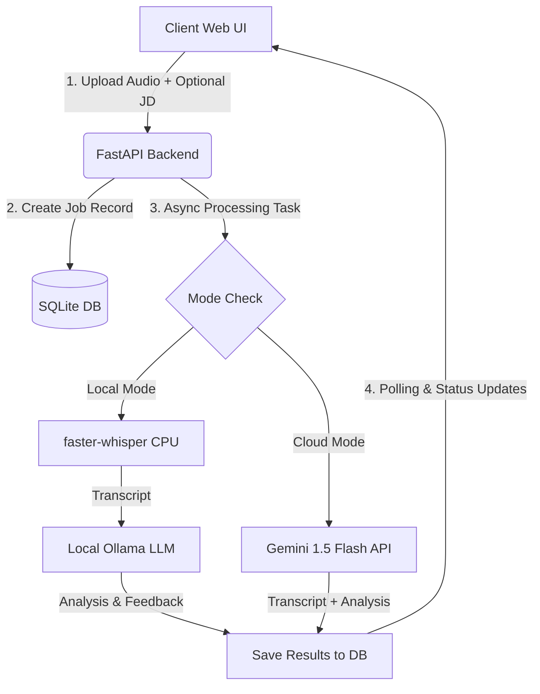

# 🎙️ Audio Transcription & AI Interview Coach

A full-stack, local-first web application designed to transcribe interview audio recordings and generate structured, actionable AI coaching feedback. Supports optional Job Description (JD) matching to evaluate candidate performance against specific role requirements.

---

## 🌟 Key Features

- **Audio Transcription**:
  - **Local Mode (Default)**: Uses [`faster-whisper`](https://github.com/SYSTRAN/faster-whisper) on CPU with `int8` quantization for efficient local speech-to-text without external API calls.
  - **Cloud Mode (Optional)**: Seamless integration with Google Gemini 1.5 Flash for ultra-fast, high-accuracy transcription in seconds.
- **Target Job Description Alignment**:
  - Optionally supply a job description to tailor the AI feedback directly against target qualifications, skills, and expectations.
- **AI Coaching & Interview Analysis**:
  - Evaluates transcripts to identify:
    1. **Key Issues**: Core challenges and topic gaps relative to the job requirements.
    2. **Mistakes Made**: Communication missteps, lack of structure, rambling, or vague answers.
    3. **Actionable Improvements**: Concrete advice and preparation strategies (e.g., STAR framework).
  - Powered by local **Ollama** (e.g., `llama3.2`) or **Google Gemini API**.
- **Asynchronous Task Processing**:
  - Background task execution using FastAPI BackgroundTasks with real-time UI polling and SQLite job tracking (`PENDING`, `PROCESSING`, `COMPLETED`, `FAILED`).
- **Modern & Interactive Web UI**:
  - Clean SPA built with Tailwind CSS, drag-and-drop audio uploader with progress tracking, interview history sidebar, and rendered Markdown analysis.
- **Docker Support**: Containerized setup ready with `Dockerfile` and `docker-compose.yml`.

---

## 🏗️ Architecture



---

## 🛠️ Tech Stack

- **Backend**: Python 3.10+, FastAPI, Uvicorn, SQLAlchemy, SQLite, faster-whisper, requests, aiofiles
- **LLM / AI**: Ollama (`llama3.2`) or Google Gemini API (`gemini-1.5-flash`)
- **Frontend**: HTML5, Vanilla JavaScript, Tailwind CSS (CDN), Marked.js

---

## 🚀 Getting Started

### Prerequisites

- Python 3.10+
- (Optional for Local LLM) [Ollama](https://ollama.com/) installed and running:
  ```bash
  ollama run llama3.2
  ```

### Installation

1. **Clone the repository**:
   ```bash
   git clone https://github.com/Ashokreddy2806/Audio_Transcription.git
   cd Audio_Transcription
   ```

2. **Create and activate a virtual environment**:
   - **Windows (PowerShell)**:
     ```powershell
     python -m venv venv
     venv\Scripts\Activate.ps1
     ```
   - **Linux / macOS**:
     ```bash
     python3 -m venv venv
     source venv/bin/activate
     ```

3. **Install dependencies**:
   ```bash
   pip install -r requirements.txt
   ```

---

## ⚙️ Configuration

You can configure the backend via environment variables:

| Variable | Description | Default |
| :--- | :--- | :--- |
| `GEMINI_API_KEY` | *(Optional)* Google Gemini API key for cloud transcription & analysis | `None` (uses local mode) |
| `OLLAMA_URL` | URL of the local Ollama instance | `http://localhost:11434` |
| `OLLAMA_MODEL` | Ollama model name to use for analysis | `llama3.2` |
| `WHISPER_MODEL` | Whisper model size (`tiny.en`, `base.en`, `small.en`) | `base.en` |

---

## 🏃 Running the Application

### Option 1: Fully Local Mode (Whisper + Ollama)
Ensure Ollama is running, then start the FastAPI server:

```bash
uvicorn backend.main:app --reload --host 127.0.0.1 --port 8000
```

### Option 2: Cloud Accelerated Mode (Gemini API)
Set your `GEMINI_API_KEY` and start the server:

- **Windows (PowerShell)**:
  ```powershell
  $env:GEMINI_API_KEY="your_api_key_here"
  uvicorn backend.main:app --reload --host 127.0.0.1 --port 8000
  ```
- **Linux / macOS**:
  ```bash
  export GEMINI_API_KEY="your_api_key_here"
  uvicorn backend.main:app --reload --host 127.0.0.1 --port 8000
  ```

### Accessing the Web UI
Open your browser and navigate to:
👉 **[http://127.0.0.1:8000](http://127.0.0.1:8000)**

---

## 🐳 Running with Docker

```bash
docker-compose up --build
```

---

## 📡 API Endpoints

| Method | Endpoint | Description |
| :--- | :--- | :--- |
| `POST` | `/api/upload` | Upload audio file (`.mp3`, `.wav`, `.m4a`, etc.) with optional `job_description` form field |
| `GET` | `/api/jobs` | List all previous transcription and analysis jobs |
| `GET` | `/api/jobs/{job_id}` | Fetch status, transcript, and analysis for a specific job |
| `DELETE` | `/api/jobs/{job_id}` | Delete a job and its records |
